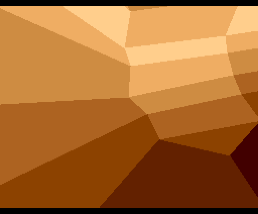
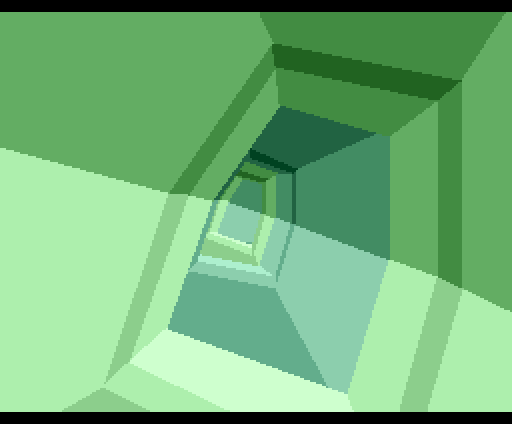

# NICCC_geo3d — ST-NICCC 2000 on MSX turbo R + V9968 + Geo3D

An unofficial fan port of Oxygene's **STNICCC 2000 Demo** (Atari STe, 1st at
STNICCC 2000) to an MSX turbo R with the V9968 VDP and the Geo3D polygon engine.
The polygon stream is Oxygene's original one, played back unchanged; the
renderer is new. There is no music.

Measured on MiSTer (MSX1 core, V9968 build, rbf 20261025a): it runs all
1,800 frames in a loop at **59.2 fps** on average (60 Hz; about 98 % of the
frames are drawn within one vertical blank). openMSX (Geo3D fork): 59.9 fps.

 

*Frames 100 and 1000 (SCREEN 5, 256x212, 2x), rendered by the port's model and
identical to the openMSX VRAM dumps.*

## Credits

The original demo, its 3D movie and its data are by **Oxygene**
(from the release's `stniccc.txt`):

| | |
|---|---|
| GFX (2d and 3d movie) | Mon / OXYGENE |
| Music | Laxity / Kefrens |
| Main coding (PC and ST) | Leonard / OXYGENE |
| STE 50Khz Music player | Lance |

* pouet: <https://www.pouet.net/prod.php?which=1251>
* demozoo: party version <https://demozoo.org/productions/59549/>,
  final version 2013 <https://demozoo.org/productions/68739/>
* The stream format and data were handed out for the 2019 STNICCC porting
  challenge; FsNICC (<https://github.com/mrange/FsNICC>) documents the format.

This port: muhanpong. The V9968 set-up sequence is adapted from kanon-ai's
V9968_Geo3D_SampleDemo (MIT); V9968 by HRA!, Geo3D by Alex Moncks (MIT) —
notices in `LICENSES/`.

## Data and rights

This repository does not contain the scene data. The build reads it from an
original Oxygene disk: both releases carry the same 639,976-byte stream
(`scene1.bin`, MD5 `0c529b0e6822d39dfba9eaf2d8332cae`) as a contiguous run of
sectors.

* party version: `OXYGEN.MSA` in <http://files.dhs.nu/party/stniccc2000/oxygen.zip>
* final version: `ST-NICC2.msa` in <http://leonard.oxg.free.fr/demos/atari/ST-NICC2.zip>

The data and everything rendered from it (the ROM, screenshots, videos) remain
Oxygene's work; neither release states redistribution terms. The MIT licence of
this repository covers only the code in `src/` and `tools/`. If the rights
holders want the ROM or the media taken down, they will be.

## Requirements

* MSX turbo R (R800) with a **V9968** VDP and **Geo3D** at ports 9Dh/9Fh.
  A stock turbo R does not run it. Tested on the MiSTer MSX1 core (V9968
  build) and on openMSX with the Geo3D fork, machine FS-A1ST_V9968.
* `NICCC.ROM`: 4 MiB, native **ASCII16X** (signature "ASCII16X" at file offset
  10h). openMSX picks "ASCII16-X" from the signature; the MiSTer core detects it
  automatically.

## Build

    python tools/build.py OXYGEN.MSA          # or ST-NICC2.msa, a raw .st, or scene1.bin

Needs Python 3 and SDCC's `sdasz80`/`sdldz80` (from PATH, or `SDCC_BIN=<dir>`).
Output: `out/NICCC.ROM` and `out/manifest.json`. The ROM is reproducible:
sha256 `36e02b6134e7119e82e9ee64bd060683003e7b170072eeea9e81df646fe44b74`
from either disk. `tools/extract_stream.py DISK [OUT]` writes `scene1.bin` alone.

## How it works

* turbo R R800, SCREEN 5 double buffered, V9968 98h-9Ch (EPAL), Geo3D V1 at
  9Dh/9Fh. Each frame: optional HMMV clear (rows 6..205), one Geo3D RUN with
  the frame's prebuilt vertex/face streams, flip at the next vertical blank,
  palette (48 bytes, EPAL) written in that same blank. The player waits for
  every command to finish before it writes to the VDP again.
* All parsing is done offline (`tools/convert.py`): the stream's clear /
  palette / indexed flags and 64 KiB blocks become one Geo3D record per frame,
  packed into 16 KiB ASCII16X banks. STE palette words (bit 3 = LSB) are turned
  into 5-bit EPAL.
* Mapping: vertex (x, y) -> model (x-128, 100-y, 0), identity matrix, TZ = F
  = 256, CX = 128, CY = 106: Geo3D projects exactly onto pixel (x, y+6).
  Equal depth for every face keeps stream order (Geo3D ties -> lower face
  number); zero normals give flat colours. Polygons > 4 vertices become fans
  of quads with the best pivot; faces start at their largest corner.
* Geo3D fills each row from the leftmost to the rightmost edge crossing, so the
  2,153 slightly concave polygons (2.9 %) fill their notches: about 9 extra
  pixels each on average.

## Checks

`tools/verify_render.py SCENE DUMPDIR TAG` compares per-update VRAM dumps from
`tools/capture.tcl` (openMSX Geo3D fork, `tools/run_emu.sh` with
`OPENMSX_GEO3D=<setup dir>`) with a Python model of the same double-buffered
drawing, frame by frame. All 1,800 frames match; the negative controls (one
face recoloured, one face dropped) must report a mismatch exactly there.
`tools/stats.py` is a per-frame cost model; on the board the real cost came out
at about 0.77x its estimate.

## Licence

Code: MIT (`LICENSE`). Third-party notices: `LICENSES/`. Scene data: see
"Data and rights" above.
